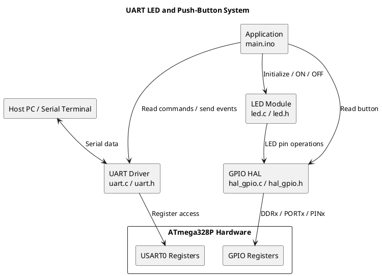
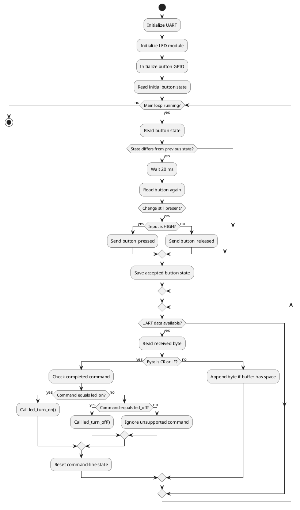
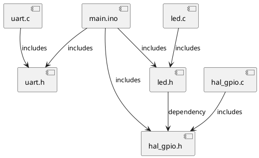

# Detailed Design Document

**Project:** UART-Controlled LED and Push-Button System  
**Author:** Hady Omar  
**Status:** Final Submission  
**Version:** 1.1  
**Date:** 22/10/2026  
**Target platform:** Arduino Uno / ATmega328P, configured for a 16 MHz CPU clock  
**Primary interfaces:** UART serial communication and digital GPIO

## 1. Introduction

This document describes the detailed design of an embedded application that receives text commands over UART, controls an LED through a GPIO output, and reports push-button state changes through UART. The design is based on the supplied project files `main.ino`, `uart.c`, `uart.h`, `hal_gpio.c`, `hal_gpio.h`, `led.c`, and `led.h`.

The application is divided into software layers. The application interprets commands and monitors the button. The LED module provides LED-level operations, the GPIO hardware abstraction layer accesses digital pins, and the UART driver manages serial communication.

### 1.1 Purpose

The purpose is to document the system architecture, module responsibilities, command handling, button monitoring, configuration, known source issues, and verification approach. The document is intended to support implementation review, debugging, testing, and maintenance.

### 1.2 Scope

Included functionality:
- Initialize the UART peripheral and use polling-based serial input/output.
- Receive commands terminated by carriage return (`CR`) or line feed (`LF`).
- Recognize the exact, case-sensitive commands `led_on` and `led_off`.
- Request LED ON/OFF operations through the LED module.
- Poll a button input and report stable press/release changes.
- Use a 20 ms delay to help debounce the button.
- Integrate the application, LED, GPIO, and UART modules.

Out of scope: a graphical PC application, wireless communication, PWM brightness control, interrupt-driven UART reception, and hardware behavior not established by the supplied source. The supplied application does not send `led_on_ok` or `led_off_ok` acknowledgements.

## 2. Architectural Overview

`main.ino` coordinates initialization, command reception, command comparison, button polling, and module calls. The LED module delegates output operations to the GPIO driver. The GPIO driver maps pin operations to ATmega328P registers. The UART driver configures USART0 and provides functions to transmit and receive data.

### 2.1 Module Responsibilities

| Module | Responsibility |
|---|---|
| Application (`main.ino`) | Initializes modules, receives and parses commands, polls the button, and dispatches actions. |
| LED module (`led.c`, `led.h`) | Exposes LED initialization, turn-on, and turn-off operations. |
| GPIO HAL (`hal_gpio.c`, `hal_gpio.h`) | Configures pin direction and provides digital read, write, toggle, and initialization operations. |
| UART driver (`uart.c`, `uart.h`) | Configures USART0 and provides serial transmit, receive, and data-availability functions. |

### 2.2 Assumptions and Constraints

- The target is compatible with the ATmega328P and AVR register definitions.
- `F_CPU` is defined as `16000000UL` in `uart.h` unless overridden by the build.
- The source configures UART for 9600 baud, 8 data bits, and one stop bit. Parity is not explicitly configured; confirm the resulting frame settings in the build.
- UART reception is polling-based.
- Commands are lowercase and case-sensitive: `led_on` and `led_off`.
- `CR` or `LF` terminates a command line.
- `command[8]` has room for seven command characters plus the null terminator.
- The button is configured as PD4 / Arduino D4, and the source comment specifies an external 10 kΩ pull-down resistor.
- The LED initializer selects PB0 / Arduino D8, while its nearby comment refers to PB3 / Arduino D11. This mismatch must be resolved against the actual circuit.
- The GPIO source contains switch-case fall-through caused by missing `break` statements; GPIO behavior must not be treated as verified until corrected.
- The supplied `main.ino` does not send LED command acknowledgements.
- Physical behavior depends on the actual wiring, LED polarity, resistor, and pin configuration.

### 2.3 Main Application Flow

## 3. Functional Description

### 3.1 UART Initialization

`Uart_Init()` configures USART0 for the UART communication settings implemented in `uart.c`. The expected baud rate is 9600 with a 16 MHz CPU clock. The driver enables transmission and reception and configures 8-bit characters with one stop bit. Reception uses polling of the UART status flags rather than a receive interrupt.

### 3.2 Command Reception and Parsing

The main loop checks `Uart_IsDataAvailable()` and obtains incoming bytes with `Uart_ReadData()`. Characters are accumulated in `command[8]`. A `CR` or `LF` marks the end of a command. The completed string is compared exactly with the supported command names. Empty lines are ignored.

The supplied source's buffer-handling behavior should be checked against the actual project version. A robust implementation must reject an entire overlong line rather than silently processing a valid-looking prefix.

| Input | Intended application action | Expected LED request |
|---|---|---|
| `led_on` | Call `led_turn_on(&led_pin)` | Set output HIGH through the LED/GPIO layers |
| `led_off` | Call `led_turn_off(&led_pin)` | Set output LOW through the LED/GPIO layers |
| Any other text | Ignore command | No LED operation |
| Empty line | Reset/retain empty command state | No LED operation |
| Overlong line | Discard the complete line | No LED operation |

### 3.3 Push-Button Monitoring

The application polls the button input and compares the current sample with the previously accepted state. When a difference is detected, the application waits 20 ms and samples again. If the state still differs, it transmits `button_pressed` for HIGH or `button_released` for LOW, then saves the accepted state. This is a simple software debounce approach; the delay briefly blocks the main loop.

### 3.4 LED Control

The LED module exposes initialization, ON, and OFF functions. The application requests LED state changes through this interface instead of writing hardware registers directly. `led_turn_on()` requests `GPIO_HIGH`, while `led_turn_off()` requests `GPIO_LOW`. The physical LED result cannot be guaranteed until the pin mismatch and GPIO defects described below are resolved.

### 3.5 GPIO Hardware Abstraction

The GPIO HAL maps port identifiers to the ATmega328P DDR, PORT, and PIN registers. Its interface includes direction initialization, logic-level writes, logic-level reads, pin toggling, and full pin initialization. In the supplied `hal_gpio.c`, missing `break` statements cause cases to fall through. In particular, a LOW write can continue into the HIGH case, and direction configuration may also be affected. Correct these cases and retest before relying on LED output behavior.

### 3.6 UART Messages and Responses

| Event | Message or behavior |
|---|---|
| LED ON command | Calls the LED ON function; no acknowledgement is sent by the supplied `main.ino`. |
| LED OFF command | Calls the LED OFF function; no acknowledgement is sent by the supplied `main.ino`. |
| Stable button press | Sends `button_pressed`. |
| Stable button release | Sends `button_released`. |

If an updated version adds acknowledgements, the caller and UART transmit function must agree on string termination and byte-count semantics. Do not document `led_on_ok` or `led_off_ok` as existing behavior in the supplied source.

## 4. Implementation of the Module

### 4.1 Application Module — `main.ino`

This file contains the entry point, button and LED descriptors, startup sequence, main polling loop, command buffer, command termination handling, and command dispatch. It calls UART, GPIO, and LED interfaces. `StringCompare()` is used to compare completed commands with supported command strings.

### 4.2 GPIO HAL — `hal_gpio.c` and `hal_gpio.h`

`hal_gpio.h` declares GPIO logic levels, direction and port identifiers, pin configuration structures, bit macros, and function prototypes. `hal_gpio.c` implements the operations through AVR registers. The switch-case fall-through defect is a source issue, not an intended feature; add appropriate `break` statements or equivalent control flow and test all logic levels and directions.

### 4.3 LED Module — `led.c` and `led.h`

`led.h` declares the LED-facing interface and its GPIO dependency. `led.c` implements initialization and the ON/OFF wrappers by calling GPIO functions. The current initializer selects PB0 / D8, but a nearby comment identifies PB3 / D11. Confirm which pin is connected to the physical LED and make the code, comments, and circuit consistent.

### 4.4 UART Driver — `uart.c` and `uart.h`

`uart.h` declares UART functions and defines `F_CPU` if it has not already been set. `uart.c` configures USART0, sends characters, checks receive availability, reads received data, and provides string transmission. The supplied `Uart_SendString()` implementation sends until a null terminator is encountered; its `Size` parameter is not used in the supplied version. Callers must therefore pass valid null-terminated strings, or the driver should be changed to enforce a length limit.

## 5. Integration and Configuration

### 5.1 Static Files

| File | Contents / responsibility |
|---|---|
| `main.ino` | Application startup, button polling, command buffer, command matching, and module calls. |
| `hal_gpio.c` | GPIO register mapping and digital input/output operations. |
| `hal_gpio.h` | GPIO types, enums, pin configuration, macros, and API declarations. |
| `led.c` | LED initialization and ON/OFF implementation. |
| `led.h` | LED module interface and GPIO dependency. |
| `uart.c` | USART0 setup, byte input/output, availability check, and string transmission. |
| `uart.h` | UART function declarations and `F_CPU` definition. |

### 5.2 Include Structure

### 5.3 Configuration Parameters

| Parameter | Value in / expected from source | Description |
|---|---|---|
| CPU clock (`F_CPU`) | `16000000UL`, unless overridden | Clock used for UART baud-rate calculations. |
| UART baud rate | 9600 baud | Must match the host terminal. |
| UART frame | 8 data bits, one stop bit; parity not explicitly configured | Confirm effective settings in the compiled firmware. |
| Command buffer | `command[8]` | Seven command characters plus null terminator. |
| Command terminator | `CR` (`\r`) or `LF` (`\n`) | Ends a command line. |
| Button port/pin | `PORTD_INDEX`, `GPIO_PIN4` / PD4 / D4 | Input according to the supplied source. |
| Button electrical bias | External 10 kΩ pull-down described in source comment | Must be present and wired correctly for active-high behavior. |
| LED port/pin | `PORTB_INDEX`, `GPIO_PIN0` / PB0 / D8 in initializer | Conflicts with the comment describing PB3 / D11. |
| LED direction | Output | Required for LED control. |
| LED logic requests | HIGH for ON, LOW for OFF | Actual output depends on corrected GPIO behavior. |
| Debounce delay | 20 ms | Delay before accepting a changed button state. |
| Receive mode | Polling | No receive interrupt is described in the supplied driver. |

## 6. Error Handling and Known Issues

1. **GPIO switch fall-through:** `hal_gpio.c` omits `break` statements in GPIO direction and logic-write switch cases. Correct and test this before hardware validation.
2. **LED pin mismatch:** The initializer selects PB0 / D8, while a comment identifies PB3 / D11. Match firmware, comments, and wiring.
3. **UART string size:** `Uart_SendString()` ignores its `Size` parameter in the supplied version and relies on a null terminator. Document or correct this interface consistently.
4. **No command acknowledgements:** The supplied `main.ino` does not transmit `led_on_ok` or `led_off_ok`. Add these only if required by the intended protocol.
5. **Button pull-down:** The source comment specifies an external 10 kΩ pull-down for PD4. Ensure the circuit contains the resistor and shares a common ground.
6. **Oversized commands:** Verify that the full overlong line is discarded and that extra characters cannot make a malformed command execute.
7. **Hardware-dependent behavior:** The software source alone cannot prove that the physical LED, resistor, button, and wires are connected as expected.

## 7. Conclusion

The project demonstrates a polling-based UART command interface, an LED abstraction module, a GPIO hardware abstraction layer, and button-event reporting. The intended commands are `led_on` and `led_off`; stable button transitions are reported as `button_pressed` and `button_released`.

Before final acceptance, correct the GPIO switch-case fall-through, resolve the PB0/D8 versus PB3/D11 LED pin mismatch, verify the UART frame configuration, and test overlong command handling. The supplied source does not send LED success acknowledgements, so such messages must not be assumed unless the implementation is updated. The physical circuit and firmware must be checked together before claiming that the LED and button operate correctly.

